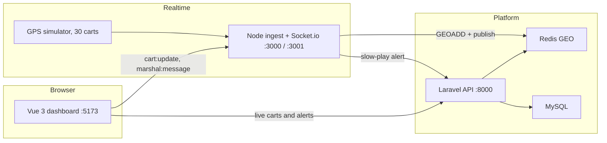

# FairwayFlow

A dockerized mini golf-fleet tracker: thirty carts report GPS, a marshal watches them move, and slow play raises an alert.

## Run

```bash
cp .env.example .env
```

Set `APP_KEY` in `.env` to a Laravel key (`php artisan key:generate --show` from the `laravel` directory, or any `base64:` value from `openssl rand -base64 32`).

```bash
docker compose up --build
```

Open http://localhost:5173. Course 1 should show carts moving around Cape Town. Laravel is on http://localhost:8000, the Node ingest API on http://localhost:3000, and Socket.io on http://localhost:3001.

The first boot migrates MySQL and seeds Peninsula (course 1), carts 1–30, and two restricted zones. The Node simulator then walks those carts and posts GPS to itself every 3 seconds.

## Architecture



Laravel owns the course, the fleet, pace rules, and history. Node owns the high-frequency GPS path and the live socket. Vue is the marshal screen. Redis GEO is the live map. MySQL stores courses, carts, geofences, alerts, and position history.

## Demo script

At RoomRaccoon I worked Laravel heavy with real-time channel manager updates. For Tagmarshal I built FairwayFlow to show the same pattern: Laravel DDD for courses and rounds, with domain logic kept pure and free of the framework; Node for high-throughput GPS; Vue for the marshal. The key decision is Redis GEO for the live view, MySQL for position history, and a GeoCoordinate value object so an invalid latitude or longitude never gets in. Here are 30 carts live. Here is slow-play detection: carts 26–28 are slow, 29 and 30 are very slow, and each worsening pace creates one alert.

## Why the split

**Laravel, domain first.** Value objects reject bad coordinates, speeds, and hole numbers. `PaceCalculationService` and `GeofenceService` are plain PHP: no facades and no database. Use cases have one `execute` method and depend on repository interfaces. Controllers only validate a request, map a DTO, call a use case, and return a resource.

**Node, DDD lite.** `IngestGpsUseCase` orchestrates. Redis and the Laravel HTTP client are adapters. The Express route and the Socket.io handler do not calculate pace or decide if a point is inside a polygon. The same 15% pace bands and the same ray cast live here so the hot path does not wait on PHP for every fix.

**Vue.** The page loads data. Composables own the socket and the merge rules. Pinia stores carts, alerts, and the connection flag, and nothing else. `CartService` and `AlertService` are the only Axios calls. The map, pace list, and alert list receive props.

**Redis GEO versus MySQL.** A live map is a geospatial index that is rewritten every few seconds. History is an append-only positions table indexed by cart and time. Alerts are written once, when a cart gets slower, not on every GPS fix.
